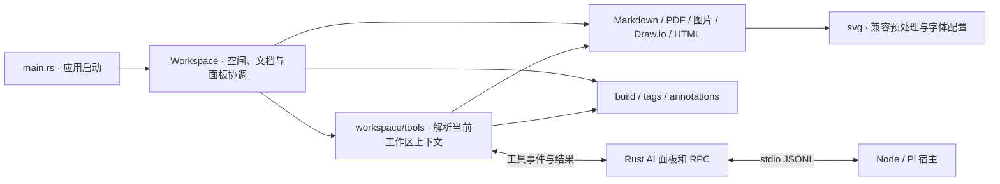

# Folio 架构与开发指南

Folio 是 Windows 原生桌面应用。Rust/GPUI 进程负责工作区、文档交互、排版和导出。HTML 预览与 Draw.io 按需使用系统 WebView2。AI 对话界面留在 GPUI 进程内，模型会话及工具宿主运行在独立 Node/Pi 进程中，通过 stdio JSONL 通信。

## 模块归属



| 需求 | 从哪里进入 | 该模块负责什么 |
| --- | --- | --- |
| 切换空间、打开保存文档、标签页、阅读分栏和文件树 | [workspace.rs](src/workspace.rs)、[workspace/](src/workspace/) | 应用状态和面板生命周期。空间切换走 `projects`，文档缓冲、监听与保存走 `documents`，文件树命令走 `file_tree`。 |
| Markdown 编辑、内容扩展与导出 | [markdown/](src/markdown/) | `pane` 管编辑、选区、大纲与面板交互，`extensions` 提供编辑器、AI 和批注共用的公式与 Callout 扩展，`pdf` 消费 GPUI 文档绘制操作。通用块模型与输入行为在 [vendored 编辑器](vendor/gpui-kit-markdown-editor/)。 |
| 公式、Mermaid、SVG 和字体 | [math.rs](src/math.rs)、[math_layout.rs](src/math_layout.rs)、[mermaid.rs](src/mermaid.rs)、[svg/](src/svg/) | 公式排版和图表各自维护渲染生命周期。通用 SVG 字节清理、兼容预处理与 `usvg` 字体配置由 `svg` 提供，图片、Draw.io、Mermaid 与 PDF 出口按需要直接调用。 |
| 文件预览与画布操作 | [pdf.rs](src/pdf.rs)、[image/](src/image/)、[drawio/](src/drawio/)、[web_view/](src/web_view/) | PDF 与图片各自管理查看器，Draw.io 拥有图表读写、画布通信与导出。WebView2 宿主与本地资源映射由 `web_view` 提供，轻量 HTML 预览也在这里。 |
| 编译与构建预览 | [build/](src/build/)、[workspace/build.rs](src/workspace/build.rs) | `build` 提供公共的构建结果、LaTeX 执行和后台批量策略。Workspace 负责保存草稿、启动前台构建、接收进度和切换预览。Markdown、图片各自生成 PDF，通过共享的构建结果回到前台。 |
| 标签、批注与撤销 | [tags/](src/tags/)、[annotations/](src/annotations/) | 标签查询、变更与撤销规则由 `tags` 管理。批注记录、定位和文件搬移由 `annotations` 管理。Workspace 与面板负责把结果反映到文件树、编辑区或阅读区。 |
| AI 会话、工具和取消 | [ai/](src/ai/)、[workspace/tools/](src/workspace/tools/)、[pi-host/](resources/pi-host/) | Rust AI 层负责面板、会话视图和消息路由。Node 负责 Pi 会话和工具注册。需要原生能力的工具由 Workspace 取得当前项目、文档或画布，再调用对应功能。 |
| 设置、主题、文案与终端 | [preferences.rs](src/preferences.rs)、[storage.rs](src/storage.rs)、[workspace/appearance.rs](src/workspace/appearance.rs)、[i18n/](src/i18n/)、[terminal/](src/terminal/) | 设置视图产生变更，`storage` 读取和迁移持久化设置，Workspace 同步各面板。共用配色与 UI 组件见 [theme.rs](src/theme.rs) 和 [ui.rs](src/ui.rs)。终端会话、ConPTY 与退出清理由终端模块负责。 |

新增代码先按行为归属现有模块。模块目录收纳同一功能的实现、状态和测试。顶层共享组件服务于实际存在的多个调用方。只有 Workspace 才掌握当前窗口和文档上下文，功能层通过参数获得需要的路径、源内容或快照。

## 数据由谁维护

| 数据 | 权威来源与写入入口 |
| --- | --- |
| 文档与草稿 | 文档保存于原路径，未保存内容由打开的文档缓冲维护。保存使用已有版本校验，外部修改冲突或文件删除时保留草稿并走冲突流程。编辑面板和阅读面板是同一文档的不同视图。 |
| 空间、标签页和设置 | 默认空间 `~/.Folio`、已登记项目和独立文件分别保存导航状态。`projects.json`、`workspace-sessions.json` 与 `preferences.json` 在 Folio 数据目录，默认 `%APPDATA%\folio-gpui`，可通过 `FOLIO_USER_DATA` 指定。打开的面板和文件树可从配置与磁盘重建。 |
| 文件标签与批注 | 标签以 SQLite 数据库为准，项目及默认空间使用 `.folio/metadata.sqlite3`，独立文件使用应用数据目录的 `loose-metadata.sqlite3`。批注记录保存在文件旁的 `.folio/annotations.json`，Markdown 内联高亮还写入正文。手动与 AI 操作共用数据和写入规则。 |
| AI 会话 | Pi JSONL 保存对话和会话名称。Folio 的 `ai-tabs.json` 与 `ai-session-metadata.json` 保存标签、置顶和标题来源等应用状态。面板切换只改变交互视图，运行中任务仍由原会话承接。 |
| 构建产物、预览和缓存 | 成功的编译或导出发布 PDF，前台预览跟随成功结果。失败时保留上一份有效预览。PDF 页图、图表光栅图、导出布局和文件树索引可从源内容重建。 |

## 常见改动怎么做

### 新增一种文档或编辑能力

1. 从 [files.rs](src/files.rs) 与 [workspace/documents.rs](src/workspace/documents.rs) 检查文件分类、打开方式、标签页及阅读分栏的入口。涉及持久化文本时沿用文档缓冲、版本冲突和文件移动流程。类型创建入口在 [workspace/file_tree.rs](src/workspace/file_tree.rs)。
2. 界面交互放到拥有该面板的模块。若行为属于 Markdown 块模型、输入或通用选择，优先在 vendored 编辑器的已有接口处实现，然后由 Folio 接入。
3. 用正常打开或编辑入口检查作用范围，特别是已打开文档与磁盘外部变化、保存后重新打开，以及适用时的阅读分栏。

### 修改渲染或导出

- **Markdown** 从同一文档布局生成编辑视图与导出绘制操作。影响布局、字体或 Markdown 节点的改动要检查屏幕和 PDF 两条路径。更新公式或 Callout 扩展时，也检查 AI 文本和批注定位的消费者。在 [markdown/pdf.rs](src/markdown/pdf.rs) 修改分页、字形嵌入或绘制操作转换。
- **图片与 Draw.io** 复用 [svg/](src/svg/) 的预处理和字体，各自保有导出尺寸、选区和错误策略。Draw.io 文件协议在 [drawio/file.rs](src/drawio/file.rs)，当前画布和导出在 [drawio/mod.rs](src/drawio/mod.rs)。AI 画布工具的实现直接位于 vendored [Draw.io App.js](resources/drawio/js/diagramly/App.js) 的应用初始化和画布生命周期中。
- **维护 vendored 资源** 优先在已有生命周期或 API 边界修复，记录 Rust vendor 补丁到 [vendor/FOLIO-PATCHES.md](vendor/FOLIO-PATCHES.md)。[install-drawio.ps1](scripts/install-drawio.ps1) 会重新解包整个 Draw.io 目录。升级时把 Folio 的本地集成迁到新版源码，再验证离线打开、选区、编辑与导出。

### 新增或修改 AI 工具

1. **确认运行位置。** 独立联网或 Python 工具由 Node 宿主注册并执行。需要活动空间、未保存文档、画布或原生存储时，复用已有 workspace tool 通道，或在确有独立归属时登记一个新通道。
2. **沿现有调用链。** Node 侧在 [host.mjs](resources/pi-host/host.mjs) 注册工具及超时，由现有 bridge 发送 `workspace_tool_request`。Rust RPC 解码，Workspace 按 `channel` 分派到 [workspace/tools/](src/workspace/tools/)，功能模块返回结果后，由 Rust AI 层发送 `workspace_tool_response`。
3. **保持请求归属与错误语义。** 宿主以通道、请求 ID 和所属会话关联回复。Workspace 验证活动项目及来自模型的路径，直接调用对应能力。后台操作处理 `workspace_tool_cancel`，沿用现有成功、失败及取消结果。依赖活动文档版本的写入在提交前复核版本。后台编译完成时只在所属项目仍处于活动状态时刷新前台文件树。
4. **验证两端。** 用针对性宿主测试核对请求、响应和取消，有文档或画布状态的工具同时检查 Rust 入口和相关行为。开发版使用仓库中的资源，打包版使用可执行文件旁的 `pi-host/` 与 `drawio/`。资源改动需要用正确的版本验证。详见 [Pi 宿主扩展开发指南](resources/pi-host/README.md)。

## 开发验证

```powershell
# 桌面编译检查
cargo check --locked --bin folio-gpui-prototype

# 按改动选择对应的行为用例
cargo test --locked --test annotations
cargo test --locked --test fold_callouts
cargo test --locked --test appearance
node --test resources/pi-host/test/drawio-plugin.test.mjs
```

构建前置条件和打包命令见 [README](README.md#构建与运行)。涉及 WebView、文件选区或 PDF 的改动，自动化通过后用独立的 `FOLIO_USER_DATA` 和临时文件走一次相关桌面入口。安装包或编译缓存属于本地生成产物，源码提交只包含运行所需资源、依赖清单和可复用的验证样例。
