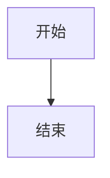

# Folio Markdown 写作提示

> 给 AI：在 Folio 中编写 `.md` 文档时遵循以下约定。Folio 是 GFM + 自定义扩展的所见即所得编辑器；下面只讲「支持什么、怎么写、避开哪些坑」。

## 基础格式

标准 CommonMark / GFM 均可用：标题、列表、引用、`**粗体**`、`*斜体*`、行内 `` `code` ``、`~~删除线~~`、裸 URL 自动链接、任务列表 `- [ ]` / `- [x]`、脚注。

```markdown
正文 **粗体** *斜体* ~~删除线~~ 和行内 `code`。
- [x] 已完成
- [ ] 待办
脚注示例[^1]，文末写：[^1]: 脚注说明。
```

原始 HTML **不会**被当作网页渲染：`<script>`、`<div>`、`<b>` 等会原样显示为文本。只有 `<u> <mark> <em> <strong> <s> <del> <br>` 和 `<details>` 有特殊含义。别用 HTML 做排版。

## 数学公式

行内用 `$...$` 或 `\(...\)`，块级用 `$$...$$` 或 `\[...\]`。围栏内侧的空格合法且会保留（`$ x^2 $` 不是错误）。

```markdown
行内：$E=mc^2$ 或 \( a^2+b^2=c^2 \)。
块级：
$$
\sum_{k=1}^{n} k = \frac{n(n+1)}{2}
$$
```

- **块级公式让围栏独占整行**（`$$` / 公式 / `$$` 三行）。紧贴正文写在一行会被强改写成独立块。
- **金额、货币符号必须转义**：写 `\$5`、`\$20`。裸 `$` 会开启行内公式；只有未闭合的 `$` 才保持字面文本，成对的 `$...$` 会被吃掉。
- **代码里的公式不渲染**：想展示 `$...$` 字面量，就放进行内代码或围栏代码块。
- 空公式（`$$ $$`）不识别；排版失败会显示 `公式 · 公式排版失败：原因` 而不是报错中断。
- 从别处复制来的 `\\(...\\)` / `\\[...\\]`（双反斜杠）也能识别，会自动规整。

## 提示块（Alerts）

引用块首行写 marker，**marker 必须独占首行**（同一行再写文字会退化成普通引用块）：

```markdown
> [!NOTE]
> 这是正文，可以多行、列表。
```

- 标准 5 种：`NOTE`、`TIP`、`IMPORTANT`、`WARNING`、`CAUTION`。
- Folio 另支持更多 badge（大小写不敏感）：`info, abstract, summary, tldr, success, check, done, question, help, faq, todo, danger, error, failure, fail, missing, bug, example, quote, cite` 等。
- 想带标题、或要折叠，用 `+`（默认展开）/ `-`（默认折叠）后缀，标题写在 marker 同行：

```markdown
> [!NOTE]+ 展开的默认标题
> 内容。

> [!TIP]- 点击展开
> 折叠起来的补充说明。
```

折叠名可自定义（如 `> [!CUSTOM]- 我的块`）。折叠只是视图状态，PDF 导出始终显示完整正文——不要靠折叠隐藏信息。

## 折叠区域 details

用原生 `<details>` / `<summary>`；summary 与正文之间**留一个空行**：

```markdown
<details>
<summary>更多细节</summary>

正文内容。

</details>
```

## emoji

文档里**直接写 Unicode emoji**（😄 ❤️ 🚀 🔥 👍）。`:smile` 只是输入时唤起候选的搜索串，选中后会替换掉，**不会**在文档里留下 `:name:`；写 `:smile:` 得不到 emoji。

## 表格

GFM 管道表格，支持左/中/右对齐（`:---` / `:---:` / `---:`），单元格可编辑。单元格内两种公式写法都保留：`$ x $` 与 `\( \frac{1}{2} \)`。

```markdown
| 变量 | 定义 | 取值 |
| :--- | :---: | ---: |
| $ x $ | \( \frac{1}{2} \) | 42 |
```

## 代码块

围栏写法 ```lang ... ```，语言 token 会被保留并用于语法高亮（Syntect）。代码块内不解析公式。

````markdown
```python
def f(x):
    return x**2   # 这里的 $ x $ 不会渲染成公式
```
````

## Mermaid 图表（桌面）

标准 `mermaid` 围栏默认显示原生图表，语言名大小写不敏感，保存时仍保留源码、原语言 token 和 meta。

````markdown

````

- 单击选择整块；双击、选中后按 Enter 或点「编辑源码」进入原代码块，沿用撤销与输入法。「显示图表」或 Escape 返回预览；只读模式不允许进入源码编辑。
- 「复制源码」复制图表代码。跨块选择复制仍包含完整 Mermaid 围栏。
- 解析与布局在后台执行；空图、语法错误及不支持的变换显示明确文字，保留源码。导出 PDF 等待全文图表完成，使用同一原生路径与字形，不导出编辑工具栏。
- 兼容范围以固定版本 `rusty-mermaid` 的实际实现为准，不保证与 Mermaid.js 全部语法、配置或布局一致。原生适配不支持非零旋转和非均匀缩放，会报错而不是静默画错。不覆盖 Android。

## 链接与图片

`Ctrl + 左键` 点击链接才跳转（普通左键进入编辑）。支持：

```markdown
[同目录](./other.md)
[工作区根相对](/guide.md)        # 从项目根目录解析
[带锚点](./guide.md#快速开始)
[外部](https://example.com)      # 系统浏览器打开
              # 图片名用尖括号包裹
```

锚点里的 `%20` 不会被解码，写锚点时用原样文字。

## 标题

正文的 `# 标题` 是正常的 H1。Folio 顶部还有一个独立的「标题输入框」，默认值取自文件名、回车会重命名文件——**它不写入正文，也不与正文 H1 联动**。不要把文件名当正文标题写进 `#`。

## 常见坑速查

| 别这样 | 改成 | 原因 |
| :--- | :--- | :--- |
| 价格 `$5` | `\$5` | 裸 `$` 会被当成公式围栏 |
| `:smile:` | 😄 | emoji 是 Unicode，不是 `:name:` |
| `> [!note] 标题` | `> [!NOTE]+ 标题` | alert marker 必须独占首行，带标题用 `+`/`-` |
| `$$a+b$$` 紧贴正文 | 三行独占块 | 块级公式围栏要单独成行 |
| 用 HTML 排版 | 用 Markdown 语法 | HTML 不渲染，原样显示 |
| `` `$ x $` `` 想当公式 | 去掉代码标记 | 代码内不识别公式 |
| 靠折叠隐藏内容 | 内容照常写 | 折叠是视图状态，导出时全部可见 |
