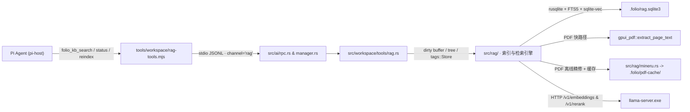
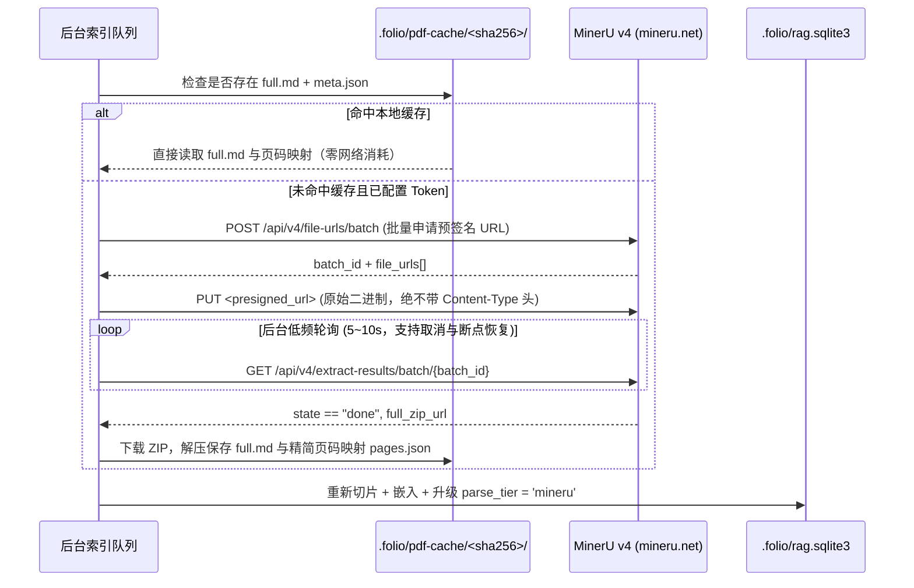

# Folio 本地个人知识库 RAG 管线实施与审阅计划

- **状态**：Stage 2 已完成并验证通过；待真机端到端联调与 Stage 3 收尾
- **开发分支**：`feat/local-rag-pipeline`（基于 `main` `@ cbb7e9f`）
- **Worktree 路径**：`D:/projects/my_projects/Latex/gpui-prototype-rag`
- **目标**：在严格遵循 [ARCHITECTURE.md](../ARCHITECTURE.md) 模块边界的前提下，参考 `tobi/qmd` 的本地极简混合检索范式，为 Folio 落地一套**原生 Rust 索引存储 + 本地 `llama-server` 开源模型推理 + MinerU 离线 PDF 精修**的个人知识库 RAG 管线。

---

## 1. 背景约束与架构取舍

### 1.1 本机硬件与环境基线

| 维度 | 实测基线 | 方案约束 |
| --- | --- | --- |
| **GPU** | NVIDIA GeForce RTX 5060 Laptop（8151 MiB / 8 GB 显存，CUDA 13.1） | 桌面常态下空闲显存约 5.5–7.0 GB；不常驻 4B FP16 模型，采用 `0.6B Q8_0` 档位（单模型约 0.8–1.0 GB）。 |
| **CPU / 内存** | Intel Core i7-14650HX / **15.6 GB RAM** | **系统内存比显存更紧张**；不常驻 Python PyTorch/LlamaIndex 服务，核心链路留在 Rust/SQLite。 |
| **本地推理后端** | `llama-server.exe`（build 12456，已识别 `Vulkan0: RTX 5060 Laptop GPU`） | 通过本地 HTTP（`/v1/embeddings` 与 `/v1/rerank`）调用 GGUF 模型上独显，避免本机 `torch+cpu` 误落回 CPU。 |
| **Folio 已有资产** | `rusqlite 0.43 (bundled)`、`gpui_pdf::extract_page_text`、`WinHttp`、`WorkspaceToolBridge` | 复用现有 SQLite、PDFium 文本提取、文件排除规则与 `pi-host` 工具通道。 |

### 1.2 面向个人知识库的刻意裁剪（对比多租户企业 RAG）

1. **无多租户与外置向量数据库**：单项目一个 `.folio/rag.sqlite3`（和 `.folio/metadata.sqlite3` 同目录），零独立 DB 服务。
2. **无重型编排框架与消息队列**：不引入 LangChain / LlamaIndex / Celery，增量同步用文件树比对 + SHA-256 去重；未保存的编辑器草稿直接从 `documents.open` 内存缓冲兜底。
3. **无独立 Query Rewrite 本地模型**：砍掉 `qmd` 原版里的 `1.7B` 扩写模型，直接让 `pi-host` 里的主 Agent 在调用 `folio_kb_search` 时填入结构化的 `lex_queries` 与 `vec_queries`。
4. **PDF 离线精修与本地兜底分离**：实时入库先用本地 `gpui_pdf` 秒级提取文本保证立即可搜，复杂学术 PDF 通过后台离线异步队列交由 **MinerU API v4** 精修并持久化缓存。

---

## 2. 模型选型与本地推理调度

### 2.1 模型组合

| 角色 | 推荐模型（GGUF） | 上下文与维度 | 显存占用 | 职责与注意点 |
| --- | --- | --- | --- | --- |
| **Embedding** | `Qwen3-Embedding-0.6B` (`Q8_0`) | 原生 32K（服务限 `-c 4096`），`1024` 维 | ~0.8–1.0 GB | 中英双语、代码与 LaTeX 公式检索强；查询时按官方模板加 `Instruct` 前缀，文档入库不加。 |
| **Reranker（Stage 2）** | `Qwen3-Reranker-0.6B` (`Q8_0`) | 限 `-c 4096` | ~0.8–1.0 GB | 必须使用包含 `cls.output.weight` 张量的新版 GGUF，启动参数带 `--reranking --pooling rank`。 |

### 2.2 `llama-server` 端口与进程调度

`llama-server` 单实例加载单一模型，采用双端口隔离（默认仅回环地址 `127.0.0.1`）：

- **Embedding 实例（默认 `127.0.0.1:18101`）**：
  ```pwsh
  llama-server -m Qwen3-Embedding-0.6B-Q8_0.gguf --embedding -ngl 99 -c 4096 -b 512 -ub 512 --host 127.0.0.1 --port 18101
  ```
- **Reranker 实例（默认 `127.0.0.1:18102`，Stage 2 惰性按需拉起 + 空闲超时自动释放）**：
  ```pwsh
  llama-server -m Qwen3-Reranker-0.6B-Q8_0.gguf --reranking --pooling rank -ngl 99 -c 4096 --host 127.0.0.1 --port 18102
  ```
- **降级契约**：当本地 `llama-server` 未配置或不可达时，**检索不报错瘫痪**，自动降级为 `FTS5` 关键词检索并在返回元数据中标记 `degraded_mode: "keyword_only"`，保证基础可用性。

---

## 3. 模块归属与整体数据流

严格遵循 [ARCHITECTURE.md](../ARCHITECTURE.md)：「功能规则留在对应模块，`Workspace` 负责上下文和协调，工具接入通过 `WorkspaceToolBridge`」。



### 3.1 涉及文件与职责清单

| 模块路径 | 归属职责 | 改动类型 |
| --- | --- | --- |
| `src/rag/mod.rs` | 模块入口、配置快照、索引/检索门面与错误类型 | 新增 |
| `src/rag/store.rs` | `.folio/rag.sqlite3` Schema 初始化、迁移、事务读写、`FTS5` + `sqlite-vec` 查询 | 新增 |
| `src/rag/chunker.rs` | `.md` / `.txt` / `.tex` / `.bib` / PDF 页文本 / 批注 的结构化切块 | 新增 |
| `src/rag/client.rs` | `llama-server` `/v1/embeddings` 与 `/v1/rerank` HTTP 客户端与健康探测 | 新增 |
| `src/rag/mineru.rs` | MinerU API v4 批量预签名上传、轮询、ZIP 解压与 `.folio/pdf-cache/` 读写 | 新增 |
| `src/rag/pipeline.rs` | 增量同步、RRF（`k=60`）、Position-Aware Blend、同文件折叠与取消控制 | 新增 |
| `src/workspace/tools/mod.rs` | 注册 `"rag"` channel 到 `dispatch_workspace_tool` 与 `ToolRequests` | 修改 |
| `src/workspace/tools/rag.rs` | `project_key` 校验、采集 dirty buffers 与 `tags::Store` 路径、后台线程与 `AtomicBool` 取消 | 新增 |
| `src/model.rs` & `src/preferences.rs` | `RagSettings`（模型端点、MinerU API Key 掩码输入、Rerank 开关、排除目录） | 修改 |
| `src/ai/mod.rs` & `src/i18n/ai.rs` | `summarize_tool_call` 中补充 `folio_kb_*` 友好工具卡片标题与双语文案 | 修改 |
| `resources/pi-host/host.mjs` | `workspaceToolChannels` 注册 `"rag"` 通道及超时策略 | 修改 |
| `resources/pi-host/tools/workspace/rag-tools.mjs` | 定义并导出 `folio_kb_search`、`folio_kb_status`、`folio_kb_reindex` | 新增 |
| `Cargo.toml` | 新增 `sqlite-vec`、`zerocopy`、`zip`（以及审阅确认后的 HTTP 客户端，见第 8 节） | 修改 |

---

## 4. 存储与 SQLite Schema 设计

### 4.1 为什么与 `.folio/metadata.sqlite3` 拆库

- `metadata.sqlite3`（[src/tags/mod.rs](../src/tags/mod.rs#L108)）存储用户手工标签，是**权威业务资产**；
- `.folio/rag.sqlite3` 是**可随时删除重建的派生缓存**，拆库可做到：
  1. 切换 Embedding 模型或切块版本时可直接重建，零风险波及标签数据；
  2. 独立 `WAL` 连接，后台批量写入不阻塞前台文件树与标签读写。
- 独立文件工作区（无项目根目录）不创建本地 `.folio/rag.sqlite3`，`folio_kb_*` 工具返回明确提示（对齐 `tag` 工具语义）。

### 4.2 `.folio/rag.sqlite3` 核心表结构

```sql
PRAGMA journal_mode = WAL;
PRAGMA synchronous = NORMAL;

-- 1. 索引代际元数据（任一核心字段变化则标记需重建向量/切片）
CREATE TABLE IF NOT EXISTS meta (
    key   TEXT PRIMARY KEY,
    value TEXT NOT NULL
);
-- 关键键：schema_version, embed_model, embed_dim, chunker_version, fts_tokenizer

-- 2. 内容去重池（重命名或移动文件，SHA-256 不变则复用已抽取文本与向量）
CREATE TABLE IF NOT EXISTS contents (
    content_hash TEXT PRIMARY KEY,
    raw_text     TEXT NOT NULL,
    parse_tier   TEXT NOT NULL,     -- 'source' | 'fast_pdf' | 'mineru'
    byte_len     INTEGER NOT NULL,
    created_at   INTEGER NOT NULL
);

-- 3. 文档目录清单
CREATE TABLE IF NOT EXISTS documents (
    id           INTEGER PRIMARY KEY,
    docid        TEXT NOT NULL UNIQUE, -- content_hash 前 8 位短码（冲突时自动加长）
    rel_path     TEXT NOT NULL UNIQUE, -- 项目内相对路径（统一 '/' 分隔）
    kind         TEXT NOT NULL,        -- 'md' | 'tex' | 'bib' | 'pdf' | 'txt' | 'annotation'
    content_hash TEXT NOT NULL REFERENCES contents(content_hash),
    mtime_ns     INTEGER NOT NULL,
    file_size    INTEGER NOT NULL,
    status       TEXT NOT NULL DEFAULT 'indexed', -- 'indexed' | 'needs_ocr' | 'skipped'
    active       INTEGER NOT NULL DEFAULT 1
);

-- 4. 结构化切片表
CREATE TABLE IF NOT EXISTS chunks (
    id           INTEGER PRIMARY KEY,
    content_hash TEXT NOT NULL,
    seq          INTEGER NOT NULL,
    heading_path TEXT NOT NULL, -- 例: "notes/opt.md > 2. KKT 条件 > 互补松弛"
    line_start   INTEGER,       -- 文本源文件 1-based 行号
    line_end     INTEGER,
    page_num     INTEGER,       -- PDF 1-based 页码
    chunk_text   TEXT NOT NULL, -- 含 heading_path 面包屑前缀的正文
    UNIQUE(content_hash, seq)
);

-- 5. 中文友好的 FTS5 词法索引
CREATE VIRTUAL TABLE IF NOT EXISTS chunks_fts USING fts5(
    chunk_text,
    heading_path,
    content='chunks',
    content_rowid='id',
    tokenize='trigram'
);

-- 6. sqlite-vec 向量表（维度按 meta.embed_dim 动态创建，Qwen3-0.6B 为 1024）
CREATE VIRTUAL TABLE IF NOT EXISTS chunks_vec USING vec0(
    chunk_id INTEGER PRIMARY KEY,
    embedding float[1024] distance_metric=cosine
);

-- 7. Rerank 分数缓存
CREATE TABLE IF NOT EXISTS rerank_cache (
    cache_key TEXT PRIMARY KEY, -- sha256(rerank_model + query + content_hash + chunk_seq)
    score     REAL NOT NULL,
    ts        INTEGER NOT NULL
);

-- 8. MinerU 离线任务追踪表（支持断点续查，重启 Folio 不丢队列）
CREATE TABLE IF NOT EXISTS mineru_jobs (
    content_hash TEXT PRIMARY KEY,
    rel_path     TEXT NOT NULL,
    batch_id     TEXT,
    state        TEXT NOT NULL, -- 'queued' | 'uploaded' | 'polling' | 'done' | 'failed'
    err_msg      TEXT,
    updated_at   INTEGER NOT NULL
);
```

### 4.3 `FTS5 trigram` 短词兜底策略

SQLite 内置 `trigram` 分词无需外部扩展即可支持连续中文和 LaTeX 宏子串匹配，但**查询词长度 `< 3` 个字符（如双字中文词 `"梯度"`、`"核范"`）时无法走 `trigram` 倒排索引**：
- 查询器拆词后，对长度 `>= 3` 的词条走 `chunks_fts MATCH ...`（BM25 排序）；
- 对长度 `1..=2` 的短词条，直接在已过滤后的 `chunks` 子集上走 `LIKE '%词%'` 轻量扫描并给固定基准词法分，兼顾准确性与零依赖。

---

## 5. 文档准入、MinerU 离线管线与切片规则

### 5.1 文件准入与 LaTeX 编译产物排除

沿用 [src/files.rs](../src/files.rs#L11-L29) 的 `EXCLUDED_DIRECTORIES`（`.git`, `.folio`, `build`, `dist`, `target`, `node_modules` 等），并针对 LaTeX 工作区增加去重防呆：
- **衍生 PDF 跳过规则**：若同目录下存在同名 `.tex` 源文件（如 `paper.tex` 与 `paper.pdf`），默认将 `paper.pdf` 视为编译产物跳过，优先索引干净的 `.tex` 源码（避免重复入库及把自己的草稿 PDF 传到 MinerU）。
- 可在工作区级 `.folio/rag.json`（可选覆盖文件）中配置 `include_dirs` / `exclude_globs` / `skip_compiled_pdf: true`。

### 5.2 分格式结构化切片（目标 ~700–900 tokens，15% overlap）

| 文件类型 | 切块边界与保护规则 | 元数据锚点 |
| --- | --- | --- |
| `.md` / `.txt` | 按 `#`~`####` 标题树切分；禁止在 ```` ``` ```` 代码块或 `$$...$$` 公式块中间切断；每块头部注入 `[path > h1 > h2]`。 | `heading_path`, `line_start`, `line_end` |
| `.tex` / `.ltx` | 按 `\part`, `\chapter`, `\section`, `\subsection`, `\subsubsection` 切分；`\begin{theorem\|lemma\|proof\|definition\|equation\|align}` 作为原子块尽量不拆。 | `heading_path`, `line_start`, `line_end` |
| `.bib` | 每条 `@article{...}` / `@inproceedings{...}` 为独立 chunk。 | `heading_path` 含 `citekey`, `line_start..line_end` |
| `.folio/annotations.json` | 每条用户批注/高亮单独作为高信号 chunk（关联被批注文件与页/行号）。 | `rel_path`, `page_num` / `line_start` |
| `.pdf`（快路径） | 调用 `gpui_pdf::extract_page_text` 按页提取；若整篇有效非空白字符过少，标记 `status = 'needs_ocr'`。 | `page_num` |
| `.pdf`（MinerU 精修） | 读取 `.folio/pdf-cache/<sha256>/full.md` + `pages.json`，**直接复用 `.md` 切片器** 并保留真实 `page_num`。 | `heading_path`, `page_num` |

### 5.3 MinerU API v4 离线解析与持久化缓存



- **缓存落盘价值**：`.folio/pdf-cache/<sha256>/` 独立于 `rag.sqlite3` 持久化；即使未来更换 Embedding 模型或重置向量库，也**无需重复消耗 MinerU 额度或等待云端解析**。
- **防 403 签名坑**：向预签名 OSS URL `PUT` 二进制文件时，HTTP 请求**禁止附带 `Content-Type` 请求头**。
- **可控触发**：考虑到隐私与额度控制，支持设置项切换：
  - `auto`：自动将独立参考 PDF 加入离线精修队列；
  - `manual`（默认建议或按用户偏好）：入库先走本地 `gpui_pdf`，由用户点击“MinerU 精修”或 AI 调用 `folio_kb_reindex({ upgrade_pdfs: true })` 时批量提交。

### 5.4 未保存草稿与 Tags 实时协同

- **Tags 预过滤**：不冗余同步标签到 `rag.sqlite3`。当查询带 `tags` / `match` 时，通过 `tags::Store` 拿到匹配 `rel_path` 集合后，直接作为检索过滤白名单。
- **Dirty Buffer 实时可见**：检索前遍历 `self.documents.open` 中 `buffer.is_dirty()` 的少量文档，内存中即时切块并与查询词做关键词/即时向量匹配，合并入候选排序，保证“刚写完还没保存也能搜到”。

---

## 6. 检索、RRF 与 Position-Aware Blend 协议

### 6.1 Pi 工具接口设计（`resources/pi-host/tools/workspace/rag-tools.mjs`）

1. **`folio_kb_search`**：
   - **入参**：
     - `query: string`（必填，原始问题）
     - `lex_queries?: string[]`（1–3 个精确关键词 / LaTeX 宏 / 英文术语）
     - `vec_queries?: string[]`（1–2 个语义描述 / 跨语言改写）
     - `mode?: "hybrid" | "keyword" | "semantic"`（默认 `"hybrid"`）
     - `tags?: string[]`、`match?: "all" | "any"`、`under_directory?: string`、`extensions?: string[]`
     - `rerank?: boolean`（默认跟随设置）
     - `limit?: number`（默认 `8`，最大 `20`）
   - **返回结构（精简定位信息，不倾倒全文）**：
     ```json
     {
       "status": "ok",
       "mode_used": "hybrid+rerank",
       "indexed_files": 420,
       "pending_mineru": 3,
       "results": [
         {
           "docid": "a3f91c2b",
           "path": "papers/kkt-survey.pdf",
           "parse_tier": "mineru",
           "heading": "3.2 Complementary Slackness",
           "page": 7,
           "line_start": null,
           "line_end": null,
           "score": 0.874,
           "snippet": "……约 300 字高密度命中片段……"
         }
       ]
     }
     ```
2. **`folio_kb_status`**：返回已索引文件数、chunk 数、MinerU 待精修数、当前模型与服务连通状态、`needs_ocr` 列表。
3. **`folio_kb_reindex`**：触发当前项目增量对齐；支持 `upgrade_pdfs?: boolean`、`force_rebuild?: boolean`。

### 6.2 融合与精排计算细节

1. **并行召回**：
   - `FTS5` 路执行 `query`（权重 `2.0`）+ `lex_queries`（各权重 `1.0`），每路取 Top 30；
   - `sqlite-vec` 路对 `query`（权重 `2.0`）+ `vec_queries`（各权重 `1.0`）取向量，每路取 Top 30。
2. **RRF（$k=60$）+ 首名保护**：
   $$\text{rrf}(c) = \sum_{L} \frac{w_L}{60 + \text{rank}_L(c) + 1} + \text{top\_bonus}(c)$$
   在任意单路排第 1 名加 `+0.05`，第 2–3 名加 `+0.02`。
3. **Position-Aware Blend（Stage 2 开启 Reranker 时）**：
   - 取 RRF Top-25，先查 `rerank_cache`，未命中部分批量请求 `/v1/rerank`。
   - 对归一化初排分 $S_{\text{rrf}}$ 与重排分 $S_{\text{rerank}}$ 按初排位次混合：
     - Rank 1–3：$0.75 \cdot S_{\text{rrf}} + 0.25 \cdot S_{\text{rerank}}$
     - Rank 4–10：$0.60 \cdot S_{\text{rrf}} + 0.40 \cdot S_{\text{rerank}}$
     - Rank 11+：$0.40 \cdot S_{\text{rrf}} + 0.60 \cdot S_{\text{rerank}}$
4. **同文件折叠**：单文档最多保留 2–3 个高分片段（相邻行段合并），防止同一篇长论文霸榜 Top 8。

---

## 7. 安全、取消语义与依赖评估

### 7.1 凭据与隐私边界
- `mineru_api_key` 与现有 `exa_api_key`、`baidu_qianfan_api_key` 保持同一存储规范：由 `AppSettings.rag`（或 `AiSettings`）持久化到用户数据目录 `preferences.json`，UI 使用掩码输入框；**严禁写入仓库或暴露给 Pi 工具参数/返回值**。
- 工具取消：沿用 [compile.rs](../src/workspace/tools/compile.rs) 模式，每次 `rag` 请求挂 `Arc<AtomicBool>` 取消标记；收到 `WorkspaceToolAction::Cancel` 后终止当前批嵌入/网络轮询并立即回传取消态。

### 7.2 `Cargo.toml` 增量依赖评估

| Crate | 用途 | 备注 |
| --- | --- | --- |
| `sqlite-vec` | 静态编译接入 `rusqlite` `vec0` | `x86_64-pc-windows-gnu`（MinGW-w64 `gcc`）经 `sqlite3_auto_extension` 静态链接，无额外 DLL，向量序列化直接走安全 `to_le_bytes()`（无需 `zerocopy`）。 |
| `zip`（`default-features = false, features = ["deflate"]`） | 解压 MinerU 返回的结果 ZIP | 纯 Rust，体积小（Stage 2 引入）。 |
| HTTP 客户端（**已定：复用 `WinHttp`**） | 调本地 `llama-server` 与 MinerU REST / OSS PUT | 相比引入 `ureq`（拉入 `rustls`/`ring` 等二十余个传递依赖），两者在 localhost 批处理与云端文件上传上无明显运行期性能差距；抽取并复用 WinHTTP 连接句柄池即可获得 HTTP/1.1 Keep-Alive，且天然继承 Windows 系统代理与零额外 TLS 依赖。 |

---

## 8. 分阶段实施与验证计划

### Stage 1：核心本地混合检索闭环（MVP）
- **范围**：
  - `src/rag/`（`store.rs` + `chunker.rs` + `client.rs` + `pipeline.rs`）：SQLite Schema、`FTS5 trigram`（含短词 `LIKE` 兜底）、`sqlite-vec`、`.md/.tex/.bib/.pdf(gpui_pdf)` 切片、`llama-server` Embedding 客户端、RRF 融合；
  - `src/workspace/tools/rag.rs` + `resources/pi-host/tools/workspace/rag-tools.mjs` + `host.mjs` 注册 `"rag"` 通道；
  - `folio_kb_search` 与 `folio_kb_status`。
- **验证**：
  - Rust 单测：切片行号/公式块保护、SHA-256 去重、中文 `trigram` + 短词查询、RRF 排序、无 `llama-server` 时降级 `keyword_only`；
  - JS 宿主测试：`rag-tools.test.mjs` 核对协议、超时与取消信号；
  - 编译检查：`cargo check --bin folio-gpui-prototype --tests`。

### Stage 2：MinerU 离线精修、Rerank 与 Folio 上下文融合
- **范围**：
  - `src/rag/mineru.rs` + `mineru_jobs` 断点状态机 + `.folio/pdf-cache/` + Middle JSON `page_num` 映射 + LaTeX 编译产物排除；
  - `Qwen3-Reranker-0.6B` `/v1/rerank` + `rerank_cache` + Position-Aware Blend；
  - Dirty buffer 内存实时匹配 + `tags::Store` 路径预过滤 + `.folio/annotations.json` 索引；
  - `src/model.rs` / `src/preferences.rs` 配置面板与 `src/ai/mod.rs` 工具卡片摘要。
- **验证**：
  - Rust 单测：MinerU ZIP 解压与页码映射 mock 测试、compiled PDF 跳过测试、dirty buffer 检索可见性测试、Position-Aware Blend 数值测试；
  - 真实端到端冒烟：在独立 `FOLIO_USER_DATA` 下用真实 `llama-server`（Vulkan0）+ 一份带公式的测试 PDF 验证入库与检索跳转。

### Stage 3：后台同步与体验打磨
- **范围**：
  - 文件保存 / watcher 防抖后台增量索引；
  - `llama-server` 健康探测与可选子进程生命周期托管（Reranker 空闲自动释放）；
  - AI 面板/状态栏轻量索引状态提示（不抢占焦点）。

---

## 9. 审阅定稿结论（已确认）

1. **HTTP 客户端**：**复用并抽共用仓库现有 `WinHttp` 封装**（`ureq` 对当前场景无明显性能优势，复用 WinHTTP Keep-Alive 句柄即可做到零新网络依赖与原生 Windows 代理支持）。
2. **MinerU 触发模式**：**默认 `manual`**（入库先用本地 `gpui_pdf` 秒建索引，显式触发再上传 MinerU 精修与缓存）。
3. **`llama-server` 托管**：**探测已有端口 + 可选按需拉起 / 空闲释放**。
4. **Stage 1 向量检索**：**直接静态编译接入 `sqlite-vec`**。
