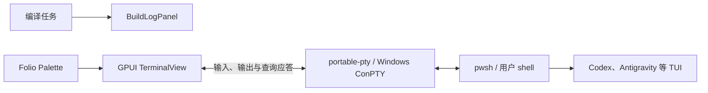

# Folio 原生嵌入终端方案

状态：已实施，尚未运行测试或 TUI 交互验收。依据当前工作区和 2026-11-13 查阅的上游源码。

## 目标与当前问题

原先 `src/workspace.rs` 的 `button("logs", "终端")` 只切换 `show_logs`。
其内容是把 `self.logs` 交给 `TextView::markdown` 显示；没有 shell、PTY 或终端状态机。

将其明确拆成两个功能：

- **编译日志**：独立的构建输出面板，保留失败自动展开、复制、状态和取消编译。
- **终端**：可从侧栏展开和隐藏的原生终端，可以运行本机 shell 及其中的 TUI。

## 选型

采用 `gpui_xterm` + `portable-pty`：前者提供 GPUI 终端视图和 Alacritty 状态机，
后者在 Windows 使用 ConPTY 创建真实终端会话。

固定 `gpui_xterm` 的源码提交
`eda177f30591e1a063e69234a6e2fb1e4edac446`，放入 `vendor/gpui-xterm`。
该提交包版本为 0.3.0，依赖 `gpui-kit ^0.9.0`，与本项目 0.9.1 属于相同依赖系列；
已接入现有 GPUI 补丁与同一套依赖图。
不以注册表是否已发布 0.3.0 作为接入前提。

固定的上游提交已有鼠标选择、滚动、剪贴板、IME、动态颜色和字号配置，
但忽略 `Event::PtyWrite`、`ColorRequest`、`TextAreaSizeRequest`，粘贴也直接写入文本。
本地 vendor 已补齐这些查询应答、括号粘贴、焦点与按键路由，并限制输出队列容量。

其他候选：

- `zortax/gpui-terminal`：依赖 `gpui 0.2.2`，README 明确列出缺少鼠标文本选择和回滚导航。
- `Xuanwo/gpui-ghostty`：已实现多项 TUI 协议，可参考协议行为；依赖 Ghostty 子模块、Zig 和另一套 GPUI 来源，当前项目接入成本更高。

## 所有权和数据流

- `TerminalSession` 拥有 PTY master、进程句柄和启动目录；读取流交给终端组件消费，输入与协议应答共用同一个写入通道。
- `TerminalView` 拥有 ANSI 解析、屏幕、光标、选区和回滚历史。Workspace 不再维护第二份终端文本。
- `TerminalPane` 拥有会话标签、当前会话、显隐和布局，引用已有会话实体。
- `BuildLogPanel` 消费编译输出，拥有显示状态；不借用终端会话、不修改 shell 的 cwd 或输入。
- Workspace 只编排项目目录、面板和命令入口。启动失败显示在该终端标签里，不关闭文档或清空编译日志。

## 界面与生命周期

终端入口放到侧栏工具区。点击展开右侧可调整宽度的终端面板；默认宽约 520px，
支持拖动加宽和临时最大化，方便全屏 TUI。现有编辑区和多阅读窗格继续存在。

面板顶部提供会话标签、新建、结束会话、最大化和隐藏。第一版支持多个独立会话，
不引入终端分屏树。

- 首次打开或点击新建时创建 shell；渲染、切换文档不创建进程。
- 隐藏只移除可见视图；会话实体、PTY 读取和 TUI 继续运行，保持最后一个有效尺寸。
- 展开后按实际字体、DPI、内边距重算字符列数和行数，同步调整终端状态及 ConPTY。
- 改变项目不会向正在运行的 shell 注入 `cd`；新建会话才使用新项目目录。
- 结束会话明确停止对应会话并回收 I/O；子进程退出后保留退出码和屏幕，不自动重启代理。
- 第一版不承诺退出 Folio 后仍运行；不把保存 PID 或回滚文本描述为进程恢复。

## Shell 和启动目录

优先使用可配置的 PowerShell 7，默认参数 `-NoLogo`，加载用户正常 profile。
不可用时允许选择 Windows PowerShell 或用户配置的 shell。

本机检查结果：`codex` 当前解析为 npm 安装的 `codex.ps1`，`agy` 当前是 PowerShell Function。
因此默认 `-NoProfile` 会使依赖 profile 的入口丢失；不能仅从 Folio 直接启动一个名为 `agy` 的 exe。
这次仅检查命令发现结果，没有启动这些代理，也没有确认 Function 的定义来源。

- 项目空间：新会话 cwd 为项目根目录。
- 默认空间：新会话 cwd 为 `.Folio` 目录。
- 独立文件：优先当前文件所在目录；没有当前文件时使用用户目录。
- 命令和参数分开传给 `CommandBuilder`，不通过拼接带引号的 shell 字符串启动。
- 继承用户环境，仅在该会话设置 `TERM=xterm-256color`、`COLORTERM=truecolor` 等已支持能力。

## TUI 协议与输入

本地终端组件按以下边界补齐行为：

1. 转发解析器产生的 `PtyWrite`，让状态、光标位置等应答能写回应用。
2. 用当前实际调色板回答颜色查询，尤其 OSC 10/11；尺寸查询使用当前有效行列和像素尺寸。
3. 粘贴检查 bracketed-paste 模式，在应用请求时使用相应起止序列。
4. 终端取得焦点时，Tab、Shift+Tab、Esc、方向键和控制组合键交给终端；避免文档快捷键截获输入。
5. Ctrl+C 发送终端中断输入；复制/粘贴使用 Ctrl+Shift+C/V。鼠标报告按应用模式转发，并保留 Shift 选择文本。
6. 保持主屏、备用屏、回滚及中文 IME 的正确行为；组词预编辑不提前写入 PTY。
7. 合并输出和重绘，限制待处理输出队列；隐藏时仍消费输出，不按历史长度反复重排整屏。

更高级的键盘协议、图像协议和跨进程恢复不作为首版兼容承诺。
Codex 和 Antigravity 的具体支持必须分别用本机实际版本运行确认。

## 主题

新增 `TerminalTheme::from_palette(&Palette)`，直接消费现有主题，不新建另一份全局主题状态。

| 终端项目 | 来源 |
| --- | --- |
| 默认背景 | `Palette.surface` |
| 默认文字 | `Palette.text` |
| 光标与未聚焦光标 | 由 `text`、`accent` 和焦点状态确定 |
| 选择底色 | `selection` 配合透明度，保持文字可读 |
| 面板边界 | `border` |
| ANSI 16 色 | 分别配套明暗调色板，保留红绿黄蓝等语义 |

主题切换调用现有会话的 `update_config`，更新默认色、ANSI 调色板和整块背景，
不重启 shell、不清空屏幕。空白区域也必须铺满终端底色。

OSC 查询必须返回这一份实际颜色，不能画面为浅色、却向 TUI 报告深色。
256 色索引和应用显式发送的 RGB 颜色按终端规则解析，不强制全部改成编辑器文字色。
应用自行固定的配色需要由应用自己的主题选项控制；默认背景查询不保证所有应用都会在运行中自动换主题。

## 文件范围与交付顺序

已新增：

- `src/terminal/mod.rs`：终端面板、标签与对 Workspace 的接口。
- `src/terminal/session.rs`：PTY、进程、启动目录、尺寸和关闭生命周期。
- `src/terminal/theme.rs`：Folio Palette 到终端颜色的映射。
- `src/build_log.rs`：从 Workspace 提取的编译日志视图。
- `vendor/gpui-xterm`：固定上游源码与上述局部协议修复，保留 MIT 许可。

现有文件只接入必要变化：`Cargo.toml`、模块声明、`workspace.rs`、`model.rs` 和 `preferences.rs`。
持久化 shell 路径/参数、终端字体字号和面板宽度；运行中 PTY/进程不序列化。

按可用能力交付：

1. 日志入口改为“编译日志”，完成独立面板；建立可新建、隐藏、恢复、调整尺寸的原生 shell 会话。
2. 补齐查询应答、粘贴和焦点路由，再分别运行实际 Codex / Antigravity TUI。
3. 接入明暗主题热更新、会话标签和设置，并处理退出和项目切换。

验收围绕实际交互：中文输入、复制粘贴、多行粘贴、方向键与 Tab、Ctrl+C、TUI 启停、
面板缩放/隐藏后恢复、切换主题、编译时继续操作终端。
已实施原生会话、多标签、侧栏入口、独立日志、设置和主题映射；隐藏不结束会话。
关闭会话或退出应用由 Windows Job Object 回收 shell 及其子进程。全局快捷键使用 `!GpuiXterm` 排除终端焦点。
按用户要求未运行测试，也没有启动 Codex / Antigravity 作交互验收；编译与安装结果由交付记录说明，实际 TUI 交互等待反馈。

## 依据

- 当前应用：`src/workspace.rs` 的 `show_logs`、`build-log` 和 `button("logs", "终端")`。
- [gpui_xterm 固定提交](https://github.com/Modolet/gpui_xterm/tree/eda177f30591e1a063e69234a6e2fb1e4edac446)
- [gpui_xterm Cargo.toml](https://github.com/Modolet/gpui_xterm/blob/eda177f30591e1a063e69234a6e2fb1e4edac446/Cargo.toml)
- [终端事件处理缺口](https://github.com/Modolet/gpui_xterm/blob/eda177f30591e1a063e69234a6e2fb1e4edac446/src/event.rs)
- [终端视图与粘贴实现](https://github.com/Modolet/gpui_xterm/blob/eda177f30591e1a063e69234a6e2fb1e4edac446/src/view.rs)
- [GPUI Kit 的组件边界说明](https://github.com/longbridge/gpui-kit/issues/2978)
- [portable-pty 0.9](https://docs.rs/portable-pty/0.9.0/portable_pty/)
- [Microsoft Pseudoconsoles](https://learn.microsoft.com/en-us/windows/console/pseudoconsoles)
- [ResizePseudoConsole](https://learn.microsoft.com/en-us/windows/console/resizepseudoconsole)
- [gpui-ghostty](https://github.com/Xuanwo/gpui-ghostty)
- [gpui-terminal](https://github.com/zortax/gpui-terminal)
